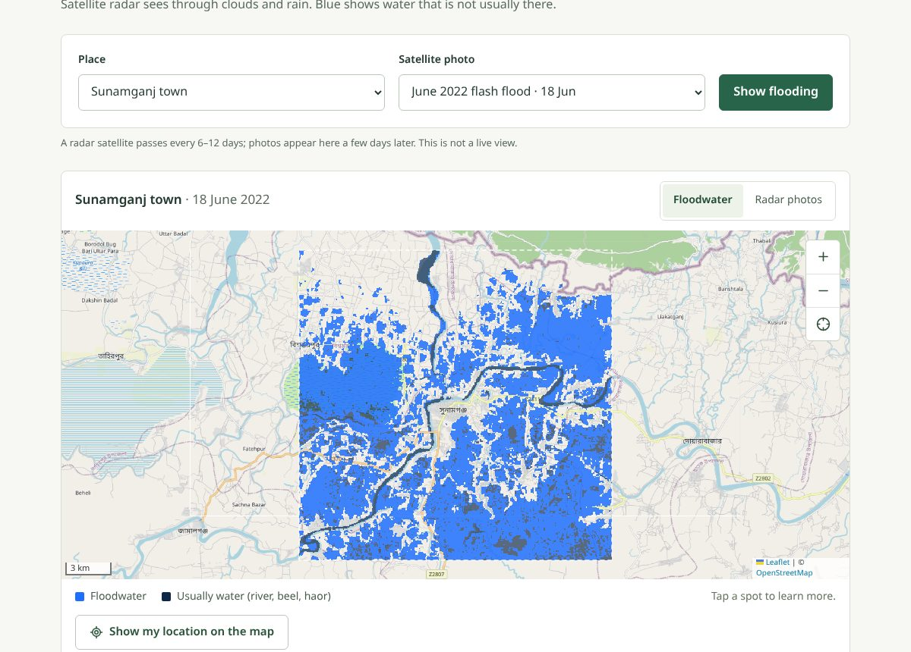
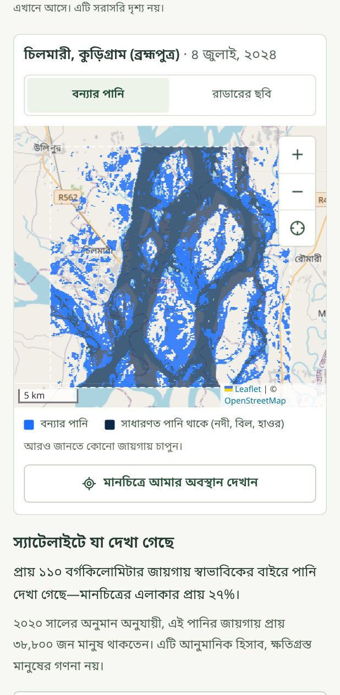
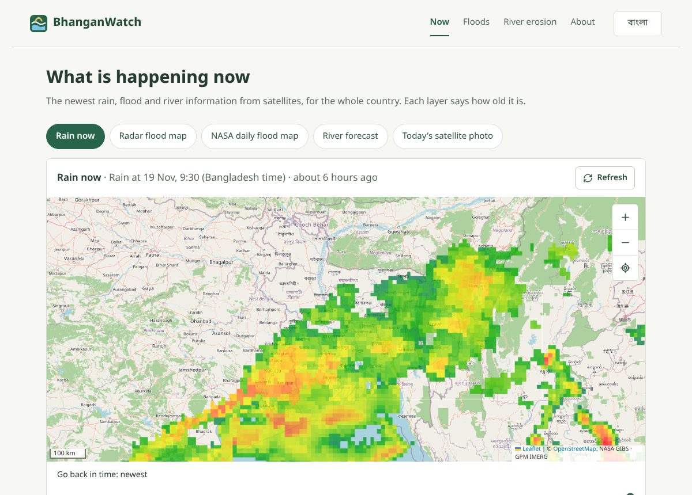
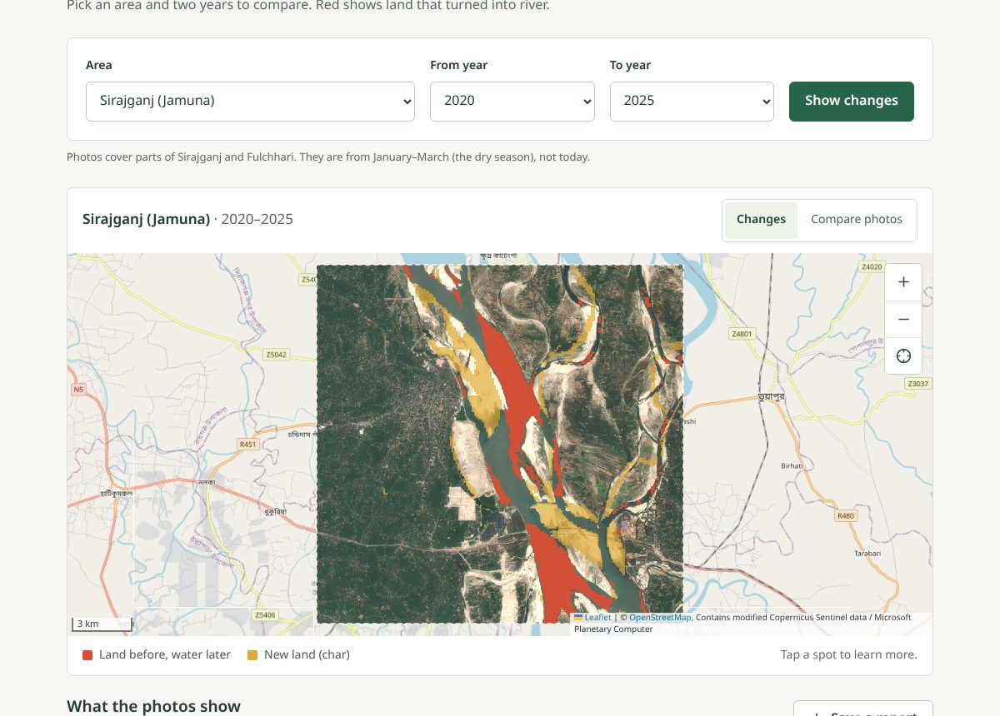

<div align="center">


# BhanganWatch · বন্যা ও নদীভাঙন

**See floodwater, rain and riverbank erosion in free satellite data of Bangladesh, in Bangla and English.**

[](https://vercel.com/new/clone?repository-url=https%3A%2F%2Fgithub.com%2FRAFI-ULL-BARI%2FBhangan-Watch&project-name=bhangan-watch)

</div>

BhanganWatch is a free web app for ordinary people, volunteers and local organisations. It works on any phone browser. It has **no server, no sign-up and no tracking**: everything runs in the browser and fetches public satellite data directly.

<p align="center">
  
  
</p>

---

## Contents

- [What it does](#what-it-does)
- [Deploy on Vercel](#deploy-on-vercel)
- [Run it on your computer](#run-it-on-your-computer)
- [How it works](#how-it-works)
- [Limits](#limits-please-read)
- [Updating the prepared data](#updating-the-prepared-data)
- [Project layout](#project-layout)
- [Data sources and credits](#data-sources-and-credits)

---

## What it does

### ⏱️ Now (এখন): the newest data for the whole country
One map of Bangladesh with five layers. Each layer says how old its data is, in Bangladesh time.

| Layer | How fresh | Detail |
|---|---|---|
| 🌧️ **Rain now**, with a slider to look back 12 hours | every 30 min, about 4–6 h behind | ~10 km |
| 🛰️ **Radar flood map** (last 3 days) | every Sentinel-1 pass, usually within a day | 20 m, sees through cloud |
| 🌊 **NASA daily flood map** | daily | ~250 m, blocked by cloud |
| 📈 **River forecast** (next 15 days) | issued daily | river network |
| 📷 **Today's satellite photo** | daily | ~375 m |



### 🌊 Floods (বন্যা): a detailed radar check for one place
- Compares a Sentinel-1 radar photo with the **dry season** (January–March) of the same year, at about 60 m detail:
  - **blue**: water that is not usually there (likely floodwater)
  - **navy**: usual water (rivers, beels, haors)
- Choose a past flood that loads instantly (Sunamganj 2022, Feni 2024, Kurigram 2024, Sirajganj 2024), or **📍 around my location** for any radar pass in the last four months.
- **At your location** tells you what the photo showed where you are standing. Tap any spot to see what each photo saw there.
- **Save a report** makes a printable one-page map. **Share** gives a link (works with WhatsApp) that opens the same place and date.
- For the prepared areas, it shows a rough estimate of how many people live where the water is (WorldPop 2020).
- It always points to the official services: [FFWC](https://www.ffwc.gov.bd), **1090** (free) and **999**.

### 🏞️ River erosion (নদীভাঙন)
- Compares dry-season Sentinel-2 photos of the Jamuna at **Sirajganj** and **Fulchhari** for 2020, 2023 and 2025. Any year from 2018 can be added on demand.
- **Red** marks land that became river; **gold** marks new char land.
- Researchers can download the results as CSV, GeoJSON or JSON.



---

## Deploy on Vercel

The app is a static site. Vercel builds it with the settings in [`vercel.json`](vercel.json), so you don't need to configure anything.

> **Before you start:** Vercel deploys the repository's default branch (`main`). Merge the pull request with this work into `main` first. Alternatively, set the Production Branch in Vercel to the branch that has it.

### Option A: one click
1. Click **Deploy with Vercel** at the top of this page.
2. Sign in with GitHub and pick a project name.
3. Press **Deploy**. After about a minute you get a link like `https://bhangan-watch.vercel.app`.

### Option B: import the repository
1. Go to [vercel.com/new](https://vercel.com/new) and choose **Import Git Repository**.
2. Select `Bhangan-Watch`. Vercel detects **Vite** and reads `vercel.json`:

   | Setting | Value |
   |---|---|
   | Framework preset | Vite |
   | Install command | `npm ci` |
   | Build command | `npm run build` (type-check + build) |
   | Output directory | `dist` |
   | Node.js version | 20.19 or newer (22 recommended) |

3. Press **Deploy**.

After the first deploy, every push to `main` updates the live site, and every pull request gets its own preview link.

### Option C: from the command line
```bash
npm i -g vercel
```
```bash
vercel          # preview deployment
```
```bash
vercel --prod   # production deployment
```

### Good to know
- **No environment variables or API keys are needed.** All data sources are public.
- **Location needs HTTPS.** Vercel provides it automatically, so "around my location" works on phones.
- **Navigation uses `#` links** (for example `/#flood?area=feni`), so no rewrite rules are needed.
- **`vercel.json`** also sets long-term caching for built files, one-day caching for `public/data`, and basic security headers.
- **Other hosts** work too, since the `dist/` folder is plain static files: Netlify, Cloudflare Pages or GitHub Pages. For a sub-folder such as GitHub Pages, build with `BASE_PATH=/Bhangan-Watch/ npm run build`.

---

## Run it on your computer

You need [Node.js](https://nodejs.org) 20.19 or newer.

```bash
git clone https://github.com/RAFI-ULL-BARI/Bhangan-Watch.git
```
```bash
cd Bhangan-Watch
```
```bash
npm install
```
```bash
npm run dev
```

Then open http://localhost:5173.

| Command | What it does |
|---|---|
| `npm run dev` | development server with live reload |
| `npm test` | unit tests for the analysis code |
| `npm run build` | type-check and build the site into `dist/` |
| `npm run preview` | serve the built site locally |
| `npm run prepare-data` | rebuild `public/data` from the satellite archives |

GitHub Actions ([`.github/workflows/ci.yml`](.github/workflows/ci.yml)) runs the tests and the build on every pull request and every push to `main`.

---

## How it works

**Floods (detailed check).** Calm water reflects radar away from the satellite, so it looks very dark.
1. Each Sentinel-1 radar photo gets its own water threshold, found automatically (Otsu's method) and kept within −18 to −13 dB.
2. **Usual water** is water in at least half of the dry-season photos.
3. **Floodwater** is water on the chosen day that isn't usual water. Isolated single cells are dropped as noise.

**River erosion.**
1. Water means NDWI > 0.05, using only cloud-free pixels (Sentinel-2 scene classes 4, 5, 6).
2. A cell **became river** if it had no water in any clear earlier photo and water in at least ⅔ of clear later photos.
3. Each period needs at least 2 clear photos.

**Getting the data.** Satellite scenes come from Microsoft Planetary Computer.
- Its data API crops and scales each scene on the server, so one area arrives as a small PNG (about 80 KB).
- A phone can run a fresh flood check in about 10–20 seconds.
- The **Now** layers are map tiles from NASA GIBS and Copernicus GloFAS, loaded straight into the map.
- The same code ([`src/lib/sources.ts`](src/lib/sources.ts)) runs in the browser and in the data-prep script.

---

## Limits (please read)

- **Not live and not a warning service.** Radar passes any one place every few days, and rain data is a few hours old. Official warnings come from FFWC and 1090.
- **Hidden water.** Radar cannot see water under trees, among homesteads or in town streets, so real flooding there is often missed. Feni in August 2024 is an example.
- **Look‑alikes.** Wind can roughen water, and wet mud or smooth sand can look like water.
- **Seasonal water.** During and after the monsoon, haors and low fields fill every year, so blue can be normal seasonal water.
- **Erosion marks.** A red erosion mark does not prove land is lost for good, and no mark does not mean a place is safe.
- **River water levels are not shown.** FFWC's data service only answers its own website, so the app links to [ffwc.gov.bd](https://www.ffwc.gov.bd) instead.

---

## Updating the prepared data

`public/data/` holds the examples that load instantly. To rebuild them:

```bash
npm run prepare-data
```
```bash
npm run prepare-data -- flood feni
```
```bash
npm run prepare-data -- erosion
```

The first command rebuilds everything (about 5 minutes); the other two rebuild one flood example or only the erosion reaches. Places, example dates and map boxes are listed in [`src/lib/areas.ts`](src/lib/areas.ts). If you are behind a proxy, run Node with `NODE_USE_ENV_PROXY=1`.

---

## Project layout

```
src/
  App.tsx              header, tabs, language switch
  NowScreen.tsx        near-real-time layers for the whole country
  FloodScreen.tsx      detailed radar flood check
  ErosionScreen.tsx    river erosion
  RiverMap.tsx         map with overlay, compare slider and location pin
  ResearchPanel.tsx    About page and research papers
  lib/
    flood.ts           flood analysis (Sentinel-1)
    analysis.ts        erosion analysis (Sentinel-2)
    sources.ts         satellite scenes → gridded observations (browser and Node)
    pc.ts              Planetary Computer search and crop client
    live-layers.ts     Now-tab layers and how fresh they are
    live-data.ts       browser downloads (loaded on demand)
    plain-language.ts  all wording, in Bangla and English
    reports.ts         printable report and downloads
    grid.ts, codec.ts, render.ts, areas.ts
public/data/           prepared examples
scripts/               data-prep script and small dev helpers
tests/                 unit tests
vercel.json            Vercel build, caching and security headers
```

---

## Data sources and credits

- **Satellite data:** contains modified Copernicus Sentinel-1 and Sentinel-2 data (ESA), processed by [Microsoft Planetary Computer](https://planetarycomputer.microsoft.com).
- **Now layers:** [NASA GIBS](https://nasa-gibs.github.io/gibs-api-docs/) (GPM IMERG rain, LANCE MODIS NRT flood, VIIRS photo) and the [Copernicus Emergency Management Service](https://global-flood.emergency.copernicus.eu/) (GloFAS forecasts, Global Flood Monitoring).
- **Population:** [WorldPop](https://www.worldpop.org) 2020 constrained estimate for Bangladesh (CC BY 4.0).
- **Base map:** © [OpenStreetMap](https://www.openstreetmap.org/copyright) contributors.
- **Research:** the project draws on Freihardt & Frey (2023), Rahman (2022), Alam & Ahamed (2023) and Islam & Mitra (2024), listed on the app's About page.

**License:** none chosen yet. Add a `LICENSE` file to say how others may use the code.

---

<p align="center">Student project by <strong>Rafiull Bari</strong> · Bangladesh</p>
